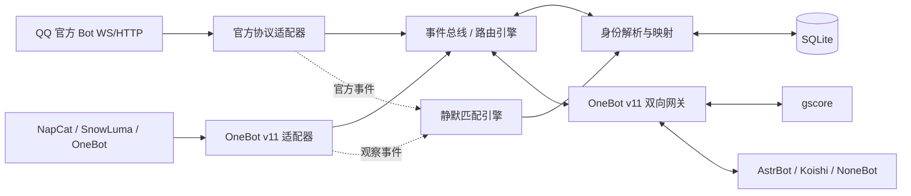

# Hashinex

> 面向 QQ 官方 Bot 与 OneBot v11 生态的多实例网关、身份统一与静默匹配中间件。

**项目状态：规划 / 开发中。** 本文描述目标架构和待办事项，功能暂未实现。

Hashinex 计划使用 **Go** 开发，独立部署，不依赖 AstrBot、gscore 或其他特定业务框架。它接收 QQ 官方 Bot 的 WS/HTTP 事件及 OneBot v11 上游消息，统一处理身份和路由，再向一个或多个 OneBot v11 下游提供服务。

## 为什么需要 Hashinex？

QQ 官方 Bot 使用 OpenID 标识用户和群聊。不同官方 Bot 对同一 QQ 用户可能使用不同 OpenID；而历史 OneBot 系统通常以真实 QQ 号存储绑定、积分和其他数据。直接将 OpenID 哈希成数字只能解决字段格式兼容，无法保证跨 Bot 的同一身份。

Hashinex 的目标是在**不修改下游业务数据库**的前提下，借助可选的静默观察 Bot，将官方 OpenID 逐步关联到真实 QQ 号，使多个 Bot 可以复用已有用户身份。

## 目标能力

- **两类上游**：QQ 官方 Bot（原生 Gateway WebSocket + HTTP API）与 OneBot v11（包括 NapCat、SnowLuma、适配器输出）。
- **统一下游**：面向 gscore、AstrBot、Koishi、NoneBot 等输出 OneBot v11；支持多个独立下游。
- **多实例路由**：按上游、下游、事件类型及可选群/用户规则配置分流。
- **身份统一**：独立保存 `(AppID, OpenID) ↔ QQ 号`、群映射、虚拟 ID 和证据记录；保留可追溯、可撤销的绑定。
- **静默观察**：指定真实 QQ OneBot 实例仅参与身份识别，不向业务下游转发事件，也不主动回复。
- **自动匹配**：关联跨 Bot 的同一条消息，再用头像 Hash 验证；默认要求 **3 条不同消息**的连续有效匹配，且无竞争候选与冲突。
- **双向 API**：处理下游请求、`echo` 关联、`self_id` 选择、消息 ID 与用户/群 ID 的反向转换。
- **可靠性**：异步匹配、有限队列、超时与背压、故障隔离、自动重连、结构化日志；匹配异常不阻塞 WS 收发。
- **独立部署**：Go 二进制、SQLite（WAL）、可配置文件和管理 WebUI（规划）。

## 目标架构

> 图示为逻辑架构。实际实现需保证观察事件不会进入业务下游；官方 API 的请求/响应需要沿原上游实例反向路由。

## 静默身份匹配（设计）

1. 官方 Bot 和配置为观察模式的 OneBot 实例接收到同一条群消息。
2. 根据时间窗口、规范化内容、事件特征及已知群映射关联事件；仅接受唯一候选。
3. 观察实例提供真实 QQ 号，官方实例提供对应 OpenID。
4. 获取双方头像，比较文件 Hash 与感知 Hash（例如 pHash）；相同头像**不是**独立的身份保证。
5. 为 `(官方 Bot AppID, OpenID, QQ 号)` 记录一次有效证据；同一原始消息去重。
6. 默认在证据有效期内连续 **3 次独立成功**，且不存在竞争候选、群映射矛盾或历史绑定冲突，才允许自动绑定。
7. 绑定后入站统一使用真实 QQ 号；出站 API 按上游上下文反向映射为 OpenID。

**初始参数（待实测调优）**：消息时间窗口 ±2 秒、事件缓存 5 秒、证据有效期 24 小时、pHash 汉明距离不大于 4、确认阈值 3 次。以上均应可配置，**不代表已验证的准确率**。

匹配失败时使用稳定且不与真实 QQ 号冲突的临时身份；头像接口故障不清零证据，明确冲突则冻结候选。正式自动绑定前应先运行影子模式，通过已知 QQ 身份统计误绑定情况。

## 可靠性原则

- WS 读写循环与头像下载、Hash 计算、数据库操作和下游处理分离。
- 匹配失败不影响基础事件转发；已确认映射可缓存，未确认身份不得冒用其他用户的 QQ 号。
- 每个连接和下游独立故障隔离，设置超时、心跳、重连与指数退避。
- 使用有限容量队列；对观察证据、业务消息、API 响应采用不同的背压与丢弃/重试策略。
- 日志记录连接、路由、匹配进度、冲突、队列积压及 API 错误；令牌和敏感信息脱敏。
- 不承诺在无限故障时仍零丢包；对不可交付的业务消息应明确报告或记录失败。

## TODO

### P0 · 调研与设计

- [ ] 审查参考项目源码、协议能力与开源许可证（BotShepherd、Gensokyo-NewQQ、OnebotNoa、qbob、WuwaIdMigration、gscore 等）。
- [ ] 验证 QQ 官方 Gateway / HTTP API、头像获取、消息 ID 与身份字段的实际行为。
- [ ] 定义模块接口、统一事件模型、身份命名空间和路由配置格式。
- [ ] 设计 SQLite 表结构、唯一性约束、迁移及回滚机制。
- [ ] 定义未绑定虚拟 ID 策略及双向 API 的上下文恢复机制。

### P1 · OneBot 网关 MVP

- [ ] 实现多实例 OneBot v11 上游连接与事件解析。
- [ ] 实现多下游 WebSocket 连接与可配置路由。
- [ ] 实现双向 API 转发、`echo` 隔离、超时与响应关联。
- [ ] 正确处理 `self_id`、消息 ID、事件去重及反向路由。
- [ ] 实现连接心跳、自动重连、优雅退出和配置加载。
- [ ] 实现结构化日志、panic 恢复、有限队列与故障隔离。
- [ ] 编写基础单元测试和双向转发集成测试。

### P2 · QQ 官方 Bot 适配

- [ ] 实现官方鉴权、Token 刷新、Gateway WS 生命周期管理。
- [ ] 实现官方事件到 OneBot v11 的转换。
- [ ] 实现下游 OneBot API 到官方 HTTP API 的转换与错误反馈。
- [ ] 明确不支持的消息类型与 API 能力，避免伪造成功。
- [ ] 测试多个官方 Bot 并发运行及异常恢复。

### P3 · 身份与静默匹配

- [ ] 实现独立身份数据库、缓存、审计和冲突检测。
- [ ] 实现 `observe` 模式，保证观察事件不进入业务下游。
- [ ] 实现跨 Bot 时间/内容消息配对及唯一候选判定。
- [ ] 实现头像下载、SHA-256、dHash/pHash 比较与常见头像降权。
- [ ] 实现按 `(AppID, OpenID, QQ号)` 独立计数、消息去重和证据过期。
- [ ] 实现默认 3 次匹配自动绑定、冻结冲突与人工修正。
- [ ] 实现群 OpenID ↔ 群号的独立验证。
- [ ] 实现入站统一 ID 与出站 ID/API 反向转换。
- [ ] 实现影子模式，测量误绑定率并设置启用门槛。
- [ ] 验证 gscore 历史数据复用和常用业务 API 的兼容性。

### P4 · 管理与运维

- [ ] 实现 WebUI 登录鉴权、输入/输出/路由管理。
- [ ] 实现身份查询、匹配进度、冲突审核及手动解绑。
- [ ] 实现实时日志、指标、告警和日志轮转。
- [ ] 实现数据库备份/恢复、配置校验和升级迁移。
- [ ] 实现队列积压、下游慢消费者、数据库锁、网络抖动等故障注入测试。
- [ ] 完成 Linux / Windows 跨平台构建及 GitHub Actions。
- [ ] 编写部署、接入、配置和故障排查文档。

## 技术选型（拟定）

| 模块 | 方案 |
| --- | --- |
| 后端 | Go |
| 上游 | QQ 官方 WS/HTTP、OneBot v11 |
| 下游 | OneBot v11 |
| 存储 | SQLite + WAL |
| 日志 | `log/slog` |
| 配置 | YAML 或 TOML（待定） |
| 管理界面 | WebUI，静态资源嵌入二进制（待定） |
| 发布平台 | Linux amd64/arm64、Windows amd64（目标） |

## 参考项目

- [BotShepherd](https://github.com/search?q=BotShepherd&type=repositories) — OneBot 多路代理与 API 路由设计。
- [Gensokyo-NewQQ](https://github.com/Te-River/Gensokyo-NewQQ) — Go 官方 QQ 协议适配。
- [OnebotNoa](https://github.com/LeiSureLyYrsc/OnebotNoa) — Go OneBot 网关。
- [qbob](https://github.com/Loping151/qbob) — 官方协议到 OneBot 的适配思路。
- [Yunzai-QQBot-Plugin](https://github.com/dndss/Yunzai-QQBot-Plugin) — 头像校验与 OpenID 绑定。
- WuwaIdMigration、gscore — 身份迁移与历史业务数据兼容性参考。

以上仅供技术调研；使用第三方代码前须核查其许可证。

## 许可证

Apache-2.0
